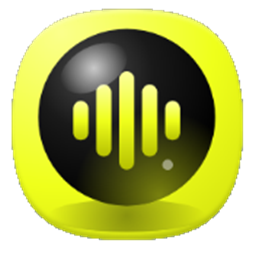
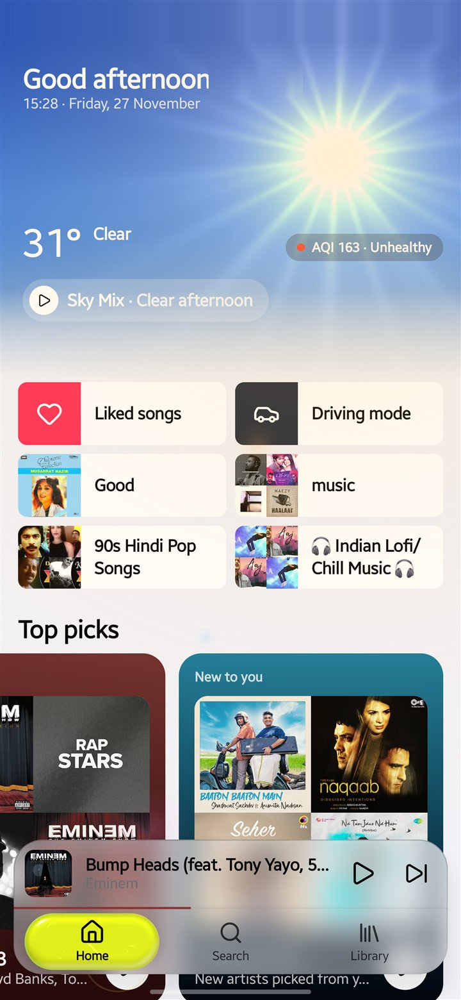
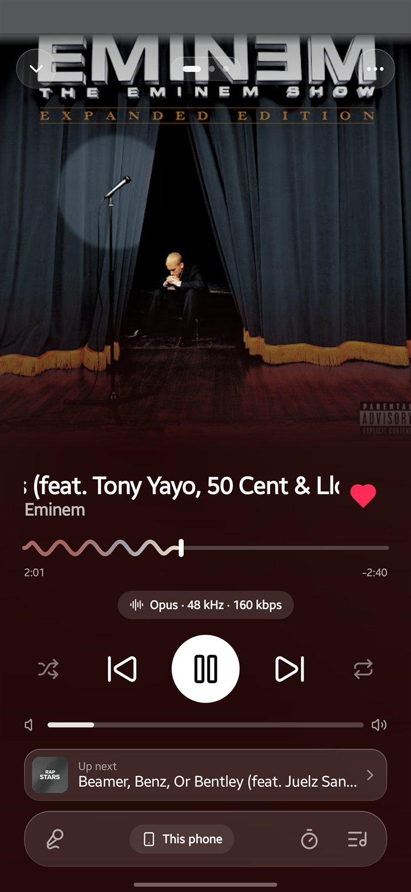
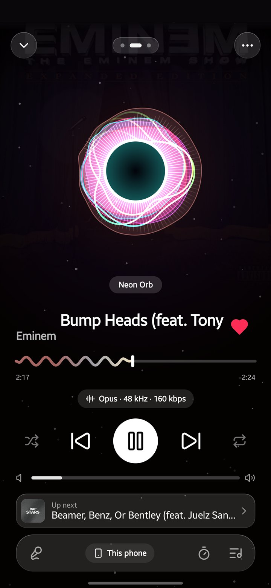
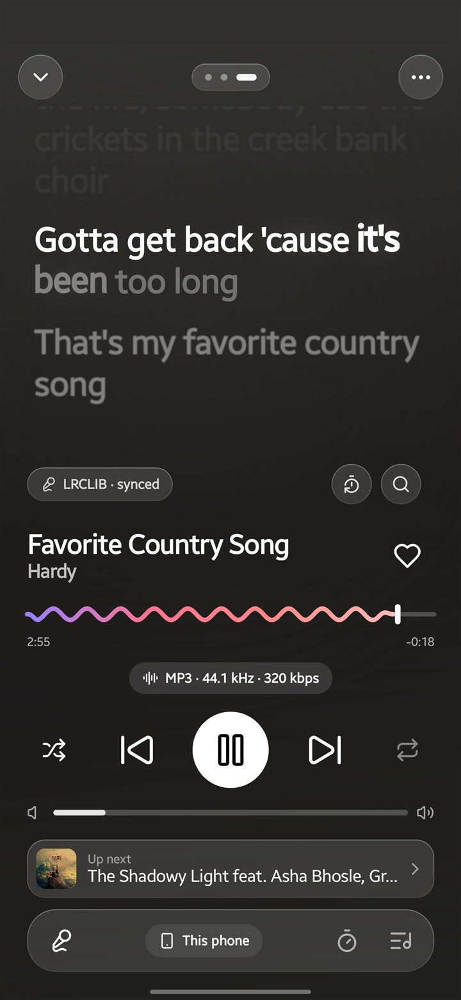
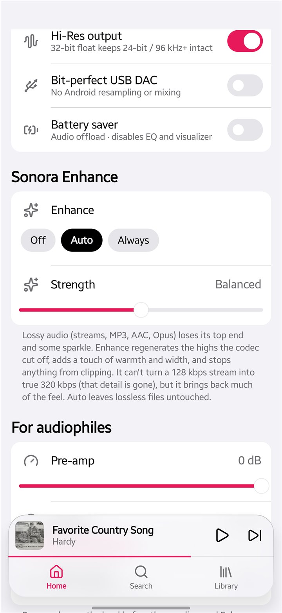
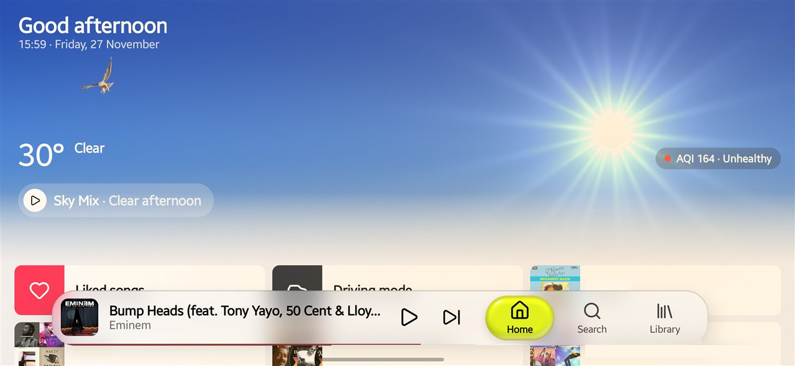
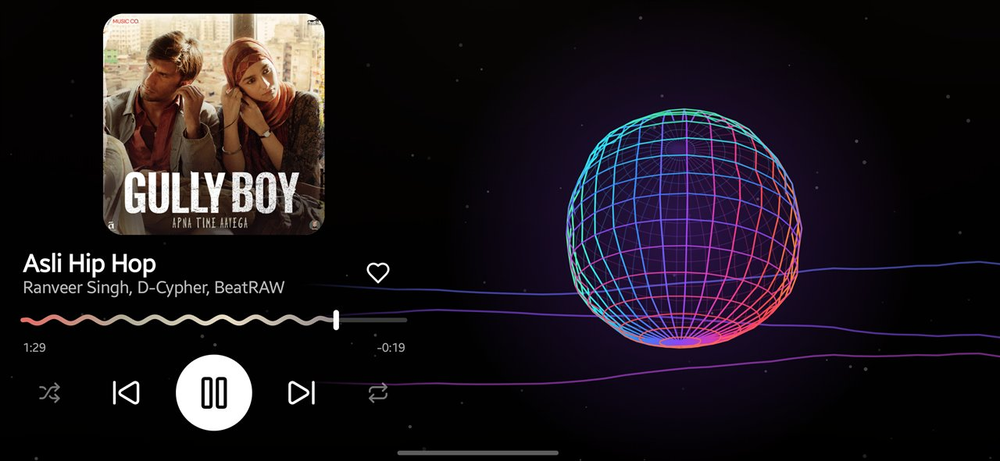

<p align="center"></p>

# Sonora

**A music player for Android that plays your own files and YouTube Music, with live visualizers, voice-driven lyrics, casting to any TV, and an audio stage built for people who care how music sounds.**

Kotlin · Jetpack Compose · Media3 (ExoPlayer). Android 8.0+, targets Android 16.

## Download

**[⬇ Download Sonora (APK)](https://github.com/siddhantmallah/sonora/releases/latest/download/Sonora.apk)**, or see all versions on the [Releases](https://github.com/siddhantmallah/sonora/releases) page.

To install: open the APK on your phone and allow "Install unknown apps" for your browser or file manager when Android asks. Sonora isn't on the Play Store (see [YouTube Music](#youtube-music) below).

After that, Sonora **updates itself**: it checks this page for new releases and installs them from inside the app (Settings → Updates).

## Screenshots

<p>
  
  
  
  
  
</p>
<p>
  
</p>
<p>
  
  
</p>

## Features

**Play anything**
- Your local library (songs, albums, artists, playlists, genres, folders) with instant accent-insensitive search
- YouTube Music: search, browse, your feed, likes and playlists when signed in, radio-style autoplay, downloads
- Gapless playback, sleep timer with fade-out, speed and pitch, skip silence
- **Smart mix**: songs really overlap (a second deck plays the outro while the next song starts). It starts on the song's own fade-out, swaps the bass halfway like a DJ so two beats never pile up, skips dead air at the end, and keeps albums gapless
- Background play, notification and lock-screen controls, Android Auto, Wear OS, home-screen widgets

**Cast to any TV**
- **Google Cast**: Chromecast, Google TV / Android TV and Cast-enabled TVs
- **DLNA**: most Samsung, LG, Sony, Panasonic smart TVs and many network speakers
- One "Cast to" list in the player; your queue moves to the TV and comes back to the phone where it left off
- Local songs and YouTube audio are streamed from the phone over your Wi-Fi while casting

**Sound**
- **Sonora Enhance**: lossy audio (streams, MP3, AAC, Opus) loses its top end. Enhance regenerates the highs the codec cut off, adds a touch of warmth and width, and has a soft limiter so nothing clips. *Auto* runs only on lossy sources. (It can't turn a 128 kbps stream into true 320 kbps, since that detail is gone, but it brings back much of the feel.)
- **For audiophiles**: Hi-Res 32-bit float output (24-bit / 96–192 kHz untouched), bit-perfect USB DAC mode (only while a DAC is plugged in), pre-amp headroom, balance, mono
- Equalizer, bass boost, virtualizer and loudness; real codec / sample-rate / bitrate shown for every track
- Bluetooth codec readout (LDAC, aptX HD, AAC…) where Android allows it

**See the music**
- Visualizers driven by the audio you're actually hearing (in sync, not on a loop): **Neon Orb**, **Wireframe** sphere, **Terrain**
- Full-screen in portrait and landscape, blending into the page

**Lyrics**
- Time-synced lyrics from LRCLIB, embedded tags or `.lrc` files, with timing correction and manual matching
- **Voice-driven words**: the word being sung swells, thickens and glows with the singer's actual voice; held notes stretch; whispers stay soft
- Works in right-to-left scripts and in landscape

**Look & feel**
- Volt yellow accent with black on top; light, dark and pure-black themes
- **Liquid tab bar**: the selected tab sits in a drop of liquid that stretches to the tab you pick, pinches off droplets, catches the light and ripples; drag along it to flick through pages
- Clear glass dock and sheets, album-coloured player
- Font choice: match your phone's font, or Inter, Manrope, Outfit, Nunito or a serif
- Scroll down and the mini player melts into the tab bar as one compact glass row; scroll up for the full dock

**Beyond the app**
- **Now-playing card buttons**: on the notification, lock screen and Now Bar, *Lyrics* puts the line being sung under the title, and *More* cycles up next (with its cover), the album and picks for you
- **Long-press the app icon**: Lyrics, Up next, Search, Liked songs, Always-On, Shuffle all
- **Always-On screen**: a dim clock, the song and its lyrics on pure black, drifting so nothing burns in. Open it from the player, or pick Sonora as the screen saver to have it show while charging

**Home**
- A live sky for your time of day: real sun and moon positions, clouds and weather for where you are, golden hour and blue hour
- Flocks of real birds that change with your region, the season, the weather and the time of day
- Daily mixes, Your Replay, recently played and recommendations

## Build

Open the folder in Android Studio, or from a terminal:

```powershell
.\gradlew.bat assembleRelease
adb install -r app\build\outputs\apk\release\app-release.apk
```

Release builds are signed with the key in `keystore.properties` / `sonora-release.jks` when they exist (both are kept out of Git). Without them a release build falls back to the debug key, so it still installs.

## YouTube Music

Sonora plays YouTube Music through an unofficial client (InnerTube + NewPipe Extractor), the same approach as ViMusic or Metrolist. That's why it's distributed as an APK rather than on the Play Store, and why a YouTube change can occasionally need an app update.

## Credits

- Lyrics: [LRCLIB](https://lrclib.net)
- YouTube Music streams: [NewPipe Extractor](https://github.com/TeamNewPipe/NewPipeExtractor)
- Bird photos: public-domain / CC0 images from Wikimedia Commons
- Moon texture: NASA Lunar Reconnaissance Orbiter

Made with ♥ by Mr.Blanko
